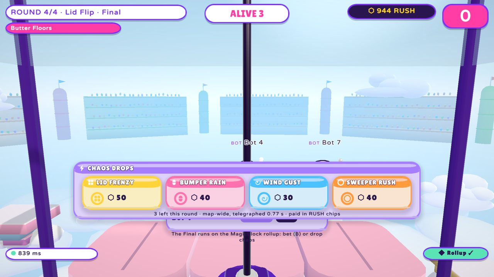

# Fall Rush

**A 3D knockout party game whose Final runs on a MagicBlock Ephemeral Rollup.** 12 wind-up capsule toys, 4 chaotic rounds, one crown, and spectators who bet and drop chaos in real time. Every match leaves a receipt on Solana that anyone can replay.

### ▶ [Play now: fallrush.fun](https://fallrush.fun) · 🎬 [Demo video](<VIDEO_URL>) · 🔎 [Proof: every system, one explorer link each](PROOF.md)



- **Play in one click**: no wallet, no popups. A guest wallet and a MagicBlock **session key** sign every move, bet and drop.
- **The Final is on-chain**: the `fall_rush` program steps the physics of *Lid Flip* at 30 Hz inside a **MagicBlock Ephemeral Rollup**, decides who is out, settles the markets and mints the Crown.
- **Entertainment finance**: spectators bet on **Rush Markets** (live odds, a **sealed** Champion market on a **Private ER**), buy **Chaos Drops** that hit the Final, and the winners keep **assets they own** (the Crown Capsule and VRF-rolled capsules, Metaplex Core).

Built for the **MagicBlock Solana Blitz V10** (theme: Entertainment Finance). Devnet; RUSH chips are test chips with no real-money value.

---

## What runs on MagicBlock

| MagicBlock feature | What Fall Rush does with it | Where |
|---|---|---|
| **Ephemeral Rollup** (devnet-as) | The program **is** the game server for the Final: a timed task calls `tick()` 30 times a second; `tick()` runs `rush-core` (our integer physics) as sBPF, ~200k CU per tick | `programs/fall_rush/src/sim.rs`, `tools/keeper` |
| **Session keys** | A guest wallet signs once; a session key signs every input batch, bet and Chaos Drop. No wallet popup during play | `packages/chain/src/session.ts` |
| **VRF** | Seeds the on-chain Final (hazards, bots) and rolls the capsule rarity per player | `request_deal` / `deal_callback`, `request_capsules` |
| **Private Ephemeral Rollup (TEE)** | The **sealed Champion market**: picks go to a private book that nobody, including us, can read until the market closes; stakes + sha256 commitments go to the public rollup; reveals are checked against the commitments (with a commit-reveal fallback) | `packages/chain/src/sealed.ts`, `tools/keeper/p6.ts` |
| **Magic Actions** | When the Match is committed and undelegated back to Solana, a Magic Action in the same transaction **mints the Crown and the capsules** (fee payer: the validator) | `finalize_match` |
| **Commit / undelegate** | Markets, receipts and the Match return to Solana; the receipt, payouts and the weekly **Season** + trophies live on Solana | `write_receipt`, `commit_econ`, `finalize_match` |

## How a match works

1. **Lobby** (Classic game server, WebSocket): you join with a name and a Rushling; bots fill 12 seats. The arena keeper creates the `Match` on Solana and delegates it to the rollup; the Rush Markets open.
2. **Rounds 1–3** (*Capsule Run*, *Goo Tower*, *Star Fountain*) run on the Classic server; every qualify / eliminate event is recorded on the rollup by the game authority (● server-recorded).
3. **The Final** (*Lid Flip*) runs **on the rollup** (◆ program-computed): the finalists join on-chain, their inputs are signed by session keys, the program steps the World, spectators' Chaos Drops enter it with a telegraph, the program declares the champion.
4. **Settle + receipt**: the program settles every market, reveals the sealed bets, writes the receipt, commits it to Solana and the Magic Action mints the rewards. `/receipt/<match>` shows it all and **replays the Final in your browser**.

## Architecture

```mermaid
flowchart LR
  subgraph Browser["Browser (Unity WebGL)"]
    U[Game client<br/>rush_core.wasm prediction]
    B[fallrush-chain.js<br/>guest wallet + session key]
  end
  subgraph VPS["Game host (untrusted helpers)"]
    GS[Classic game server<br/>rounds 1–3]
    K[Arena keeper<br/>timed task, settle, retries]
    I[Indexer / replay archive]
  end
  subgraph ER["MagicBlock Ephemeral Rollup (devnet-as)"]
    P[fall_rush program<br/>tick(): rush-core sBPF, 30 Hz<br/>markets · drops · receipt]
  end
  TEE["Private ER (TEE)<br/>sealed Champion book"]
  SOL[("Solana devnet<br/>Match · receipt · Season<br/>Crown + capsules (Core)")]
  U <-->|WebSocket| GS
  B -->|inputs, bets, drops<br/>session-key signed| P
  P -->|account updates| U
  B -->|sealed pick| TEE
  GS -->|round events| K -->|record + schedule ticks| P
  P -->|commit + undelegate<br/>+ Magic Action mint| SOL
  K -->|archive inputs + Worlds| I
  Web["/live · /receipt · /replay"] -->|subscribe / verify| P
  Web --> I
```

**Trust model** (what is and isn't proven):
- The rules of the Final are public program code, run by MagicBlock's rollup validator; its inputs are signed by each player's session key; results and payouts are computed by the program and committed to Solana.
- Rounds 1–3 are decided by our Classic game server and **recorded** on-chain by the game authority (● on the receipt); only the Final is **computed** on-chain (◆).
- Anyone can replay the Final from the archived inputs with `rush-core` and get the same bytes (below).
- **Still trusted:** the rollup operator for transaction ordering and liveness; the TEE operator for keeping sealed picks private until close (the commit-reveal fallback keeps settlement honest either way).

## Replay a match yourself

Every archived match can be re-simulated tick by tick and compared byte for byte with the Worlds the rollup produced:

```bash
git clone <this repo> && cd fall-rush
node tools/p7/replay-check.mjs <match address>                      # Node 20+, no install
# e.g. node tools/p7/replay-check.mjs G43jUdkySw27WegtCFnsNEQhgeqMTnFq2WreD1yGkWWg
# → {"pairs": 3837, "byteExact": 3837, "finalTranscriptInLastWorld": true, "pass": true}  replay = on-chain ✓
```

It downloads the match's archive from the public indexer (`--base https://fallrush.fun`), loads `client-unity/Assets/StreamingAssets/rush_core.wasm` (the same `rush-core` the program runs) and checks every tick plus the receipt's Final transcript. In the browser: **fallrush.fun/receipt/&lt;match&gt;** runs the same check; **/replay/&lt;match&gt;** plays it.

## `rush-core`: a 3D character controller for Ephemeral Rollups

`crates/rush-core` is the reusable part: a `no_std`, integer-only, allocation-free 3D character controller and game-rules core (capsule motor, slopes, jumps, dives, collisions with moving hazards, round director, bots, Chaos Drops) that compiles to **three targets from one source**: native (tests, tools), **WASM** (client prediction, web replay) and **sBPF** (the on-chain authority). Same inputs → the same bytes everywhere; the program, the Unity client and the browser share it, which is what makes the on-chain Final both playable and replayable. Map geometry is a compact blob (`maps/*.mapblob`) hashed into the receipt.

## Run it locally

Prereqs: Node 24 + pnpm 10, Rust (sBPF toolchain via `solana-cli` 3.1.x), Anchor 1.0.2, Unity 6000.3.28f1 (WebGL + Linux server modules). The full phase-by-phase instructions are in [`docs/DEV-NOTES.md`](docs/DEV-NOTES.md); the short version:

```bash
pnpm install
bash scripts/p1-check.sh                      # rush-core: native tests + WASM + sBPF build + cross-target vectors
bash scripts/p5-local-hybrid.sh               # a local hybrid match: Classic server + local validator + keeper
node packages/chain/scripts/build.mjs         # the browser chain bundle
(cd web/app && node scripts/assets.mjs && npx vite build)   # the web app (/play, /live, /receipt, /replay, /me, /season)
```

Program ID **`4yehffTS5zxw9vqHpmiAgxoqqUDBVgrCTyH5eyL4Dsk4`** (devnet) · RUSH mint `3s8KstqicXn1kgFyWPVq3AZXkMprDtEtT7BNTxtQccEw`.

## Docs and proofs
- [`PROOF.md`](PROOF.md): one explorer link per system, each with what it proves.
- [`docs/proof/`](docs/proof/): per-phase proofs (devnet runs, numbers, what is UNVERIFIED). The latest: [`P7-launch.md`](docs/proof/P7-launch.md) (polish, load + chaos tests, launch).
- [`docs/19-ONCHAIN-PLAN.md`](docs/19-ONCHAIN-PLAN.md): the on-chain architecture and phases; [`docs/15-DECISIONS-AND-RISKS.md`](docs/15-DECISIONS-AND-RISKS.md): every decision.

## Roadmap
- **Mainnet** after a legal review of the chip economy (today: devnet test chips only).
- **All 4 rounds on-chain** (today rounds 1–3 are server-recorded, the Final is program-computed).
- **Permissionless arenas**: anyone runs a keeper and opens an arena; **community maps** as map blobs.
- Season rewards beyond the trophy; spectator leagues.

## Team, credits, licences
Built by the Fall Rush team with Claude Code. Fonts: Lilita One, Varela Round, Noto Sans Symbols 2 (SIL OFL 1.1). All art, meshes, music and sound are our own (generated in code / Blender / a synthesiser): see [`ASSET_LICENSES.md`](ASSET_LICENSES.md). Code: [MIT](LICENSE). Original game: no assets, layouts or designs from other games (doc 17 §1).
