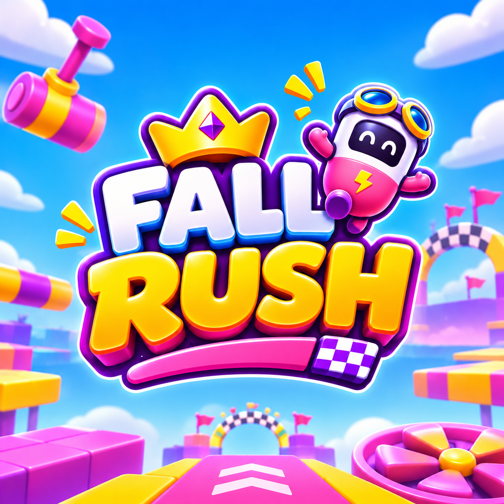
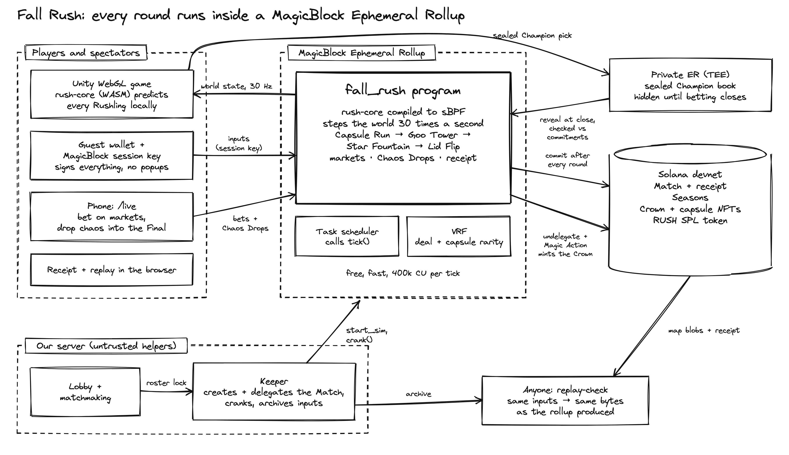
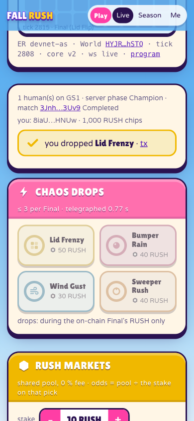

<div align="center">



## Bet on it. Sabotage it. Win the Crown.

A 12-player knockout party game in your browser. On our on-chain arenas, every round is simulated by a Solana program inside a **MagicBlock Ephemeral Rollup**, 30 times a second. Spectators bet on the match from their phones and spend chips to drop chaos into the Final. The champion's Crown is minted on Solana.

**[Play your own on-chain match (judge mode)](https://fallrush.fun/play?judge=1)**

[Demo video]({{DEMO_VIDEO_URL}}) · [Explorer proof](PROOF.md) · [fallrush.fun](https://fallrush.fun) · [X @fallrushdotfun](https://x.com/fallrushdotfun) · Program [`4yehff…Dsk4`](https://explorer.solana.com/address/4yehffTS5zxw9vqHpmiAgxoqqUDBVgrCTyH5eyL4Dsk4?cluster=devnet)

</div>

<!-- {{HERO_GIF}}: replace the next line with  -->
## The on-chain Final: Lid Flip with the Chaos Drop menu open


| Compete | Bet | Sabotage | Own |
|---|---|---|---|
| 12 players, 4 rounds, about 6 minutes. Bots fill empty seats. | Live pool markets on who qualifies and who wins, with odds that move as the match plays. | Spend chips to drop Lid Frenzy, Bumper Rain, Wind Gust or Sweeper Rush into the Final. | The program pays winners. The champion's Crown and each player's capsule are minted as NFTs. |

## What it is

Twelve Rushlings, wind-up capsule toys with noodle arms, play four rounds: a race (*Capsule Run*), a climb away from rising goo (*Goo Tower*), a star scramble (*Star Fountain*) and a Final on flipping lids (*Lid Flip*). Each round knocks players out until one is left.

Most on-chain games run on an ordinary server and write the results to a chain afterwards. Fall Rush puts the game itself on-chain. Movement, jumps, dives, collisions, hazards, and who qualifies and who falls are all computed by our program, `fall_rush`, on a MagicBlock Ephemeral Rollup. Our server runs the lobby and hands the match over. After that it can stall or abort a match (an abort refunds every market), but it can't pick who wins.

Because the result comes from the program, spectators can bet on it. The program settles the bets, writes a receipt to Solana and mints the Crown.

No wallet is needed. The page makes a guest wallet and a MagicBlock session key, which sign your inputs, bets and drops in the background.

## Architecture



The game server only seats players. From roster lock, the `fall_rush` program on the rollup runs every round, settles every market and writes the receipt; Solana keeps the Match, the receipt, Seasons and the NFTs.

## Try it in two minutes

1. **Play.** Open **[fallrush.fun/play?judge=1](https://fallrush.fun/play?judge=1)** on a desktop. You get your own room and a full 4-round on-chain match (about 6–7 minutes). Use WASD to move, Space to jump and Shift to dive. The **◆ Rollup ✓** badge in the corner means the program is running the round.
2. **Bet and sabotage.** Scan the QR code in the corner with your phone. On `/live`, bet on the markets and drop chaos into your own Final.
3. **Verify.** When the match ends, open its receipt at `fallrush.fun/receipt/<match>`. It lists every transaction and replays the match in your browser against what the rollup produced.

You don't install anything or bring SOL: the guest wallet is funded for you, and bets use devnet test chips. There are two on-chain arenas. If both are mid-match you'll wait a few minutes. If the rollup doesn't start within 60 s, the match plays on our backup server, the badge reads **● Server**, and the receipt records the abort and the refunds.

<!-- {{SCREENSHOTS}}: optional row of 3 shots from the LIVE build: Capsule Run with the ◆ Rollup ✓ badge · phone /live with a bet placed · a receipt page showing the replay check passed.
     Don't reuse docs/proof/p7/polish/after/game/soft-1080-05-race-hud.jpg: it shows the old "● Server" badge from before rounds 1–3 moved on-chain. -->
<p align="center">
  
</p>

## How you win, and what you own

All of this uses **RUSH devnet test chips**: 1,000 free from the faucet every 24 hours. There's no real money until the chip economy has had a legal review.

- **Markets.** Each match opens 5 pool markets: qualify in round 1, 2 or 3, Final winner, and Champion. Stakes sit in vaults owned by the program, with no fee. When a market resolves, the winners split the pool in proportion to their stakes. A market-maker account, labelled as such in the UI, seeds every pool so there are odds from the first second.
- **The sealed Champion market.** Your pick goes into a book inside MagicBlock's **Private Ephemeral Rollup**, which runs in secure hardware (a TEE). Only your stake and a hash of your pick are public. Your browser verifies the TEE's hardware attestation itself. When betting closes, picks are revealed and checked against their hashes. If the TEE is down, a plain commit-reveal fallback takes over.
- **Chaos Drops.** These cost 30–50 chips, which go into a program-owned pot shown on the receipt. They're Final-only, at most 3 per round and 5 s apart. Each is announced 0.77 s before it lands, and it hits the whole map, never a single player.
- **Cash out.** Chips convert to the RUSH SPL token on Solana ([250 RUSH minted](https://explorer.solana.com/tx/4qnt6mkNNqy1weCxsTqi2HC7j17r12HLjMxb3a4vdyvgFtw99GVrGrcAiVruhwsNW1fYJfEREnMQRW1grxnooUWs?cluster=devnet)).
- **Keep.** The champion gets a Crown, and every human gets a capsule whose rarity is rolled by VRF (Common 70%, Rare 22%, Epic 7%, Legendary 1%). Both are Metaplex Core assets on Solana.

## Why it needs MagicBlock

A 12-player physics game needs a new world state every 33 ms. Solana's base layer can't do that, and fees on every frame would be absurd. On an Ephemeral Rollup the match account is delegated to MagicBlock's validator, the program steps the world there at 30 Hz with no fees, and the Match is committed back to Solana after every round.

| In the game | MagicBlock piece | Proof |
|---|---|---|
| Physics, qualifying and knockouts for all 4 rounds, at 30 Hz | **Ephemeral Rollup.** MagicBlock's task scheduler calls `tick()`, and a permissionless crank sends `crank()` for the heaviest 12-player ticks | [one on-chain physics step](https://explorer.solana.com/tx/4iZaSrLVAp6WT7WcXFEHXKHamQGJrJtNkQnfhA5nqHFLJVXJo1UH661y21K8xZfuVMBMSct3qojJFjuNLMw7j6YQ?cluster=custom&customUrl=https%3A%2F%2Fdevnet-as.magicblock.app) |
| Playing and betting without wallet prompts | **Session keys.** The program re-checks the session token on every input | [a player's input batch](https://explorer.solana.com/tx/4ALvs94GFGS2ztur9VhVt5nPwMiEccVHiXrdBpwWWe8jt6Shn4GaVaN8xBpAv9KZMSUX6bwtmZLvUnRDaqeojCeG?cluster=custom&customUrl=https%3A%2F%2Fdevnet-as.magicblock.app) |
| The match deal (hazard seeds, bots) and capsule rarity | **VRF**, requested and answered inside the rollup | [the VRF callback](https://explorer.solana.com/tx/4oN3YMJ6zu8UnhNSk8an9thkeZx8RQR7dFzNT7opUHaNe2QxK9HRjcGkAmzA22d5P5gfyVfvQUfq8kTjD9MrshP7?cluster=custom&customUrl=https%3A%2F%2Fdevnet-as.magicblock.app) |
| Champion picks stay hidden until betting closes | **Private Ephemeral Rollup (TEE)** | [a sealed pick revealed](https://explorer.solana.com/tx/5hHtAaQaSkAo2MzPZYsVQn832ftQ5P9oWfJkC4hZw95XW3wLZCwFmbmMg3nekBZymUA1WT2w9FWfBL454sY3xFXq?cluster=custom&customUrl=https%3A%2F%2Fdevnet-as.magicblock.app) |
| The Crown and capsules appear when the match ends | **Magic Actions.** The validator lands commit + undelegate on Solana, and the post-undelegate action creates the assets. The validator pays the fee, and our keeper sends no mint transaction | [commit + mint on Solana](https://explorer.solana.com/tx/3Aa85KzvbYbEsZGT3W1hYEHNMH12co9EMPTe4oAGkweRb5GpLqJA4B3iEPK3DPEADvwi9AVz1xJgkyeWjxh1Xdoa?cluster=devnet) |
| A permanent receipt for every match | **Commit and undelegate** | [the Match account](https://explorer.solana.com/address/Hxf8ae7ymYhyNcjEhKuah8y1FHfV4fkVYkk4VqnqAYDn?cluster=devnet) |

Rollup links open in Solana Explorer through a custom RPC, so click **Connect** once when Explorer asks. [`PROOF.md`](PROOF.md) lists one link per system. Most come from a single full on-chain match, and the rows taken from earlier test runs say so.

## On-chain addresses (devnet)

| What | Address |
|---|---|
| `fall_rush` program | [`4yehffTS5zxw9vqHpmiAgxoqqUDBVgrCTyH5eyL4Dsk4`](https://explorer.solana.com/address/4yehffTS5zxw9vqHpmiAgxoqqUDBVgrCTyH5eyL4Dsk4?cluster=devnet) |
| RUSH token mint (cash-out) | [`3s8KstqicXn1kgFyWPVq3AZXkMprDtEtT7BNTxtQccEw`](https://explorer.solana.com/address/3s8KstqicXn1kgFyWPVq3AZXkMprDtEtT7BNTxtQccEw?cluster=devnet) |
| Arena 2 · its World (live game state on the rollup) | [`HbinPthhN3g5BRQRL4aKQ75HyQXMofhsUbg2c28bJXHt`](https://explorer.solana.com/address/HbinPthhN3g5BRQRL4aKQ75HyQXMofhsUbg2c28bJXHt?cluster=custom&customUrl=https%3A%2F%2Fdevnet-as.magicblock.app) · [`HYJRSXpSGZ3HdjmZr4oMy3x6VgTWLcarkgHav7L4hSTQ`](https://explorer.solana.com/address/HYJRSXpSGZ3HdjmZr4oMy3x6VgTWLcarkgHav7L4hSTQ?cluster=custom&customUrl=https%3A%2F%2Fdevnet-as.magicblock.app) |
| Arena 3 · its World | [`E9XE7vtQgrWnXLcGMn5FYXAFLb6GmBjrKcZq5wgPcEbG`](https://explorer.solana.com/address/E9XE7vtQgrWnXLcGMn5FYXAFLb6GmBjrKcZq5wgPcEbG?cluster=custom&customUrl=https%3A%2F%2Fdevnet-as.magicblock.app) · [`9Q5KBadvfx3Yoen1uqLUgbU1x6tXn4GmkEkjGqfPuRWn`](https://explorer.solana.com/address/9Q5KBadvfx3Yoen1uqLUgbU1x6tXn4GmkEkjGqfPuRWn?cluster=custom&customUrl=https%3A%2F%2Fdevnet-as.magicblock.app) |
| Rewards treasury (pays Crown and capsule rent) | [`9xbM3zEDrC3Lp7TeuKpFVugnPsc1JaDweWf6htqBFKqh`](https://explorer.solana.com/address/9xbM3zEDrC3Lp7TeuKpFVugnPsc1JaDweWf6htqBFKqh?cluster=devnet) |
| This week's Season board | [`146ckQu8q2rZP34oF7ggnJBoGYtX3ZKFa9jkiEPi63ee`](https://explorer.solana.com/address/146ckQu8q2rZP34oF7ggnJBoGYtX3ZKFa9jkiEPi63ee?cluster=devnet) |
| Example full on-chain Match (receipt on Solana) | [`Hxf8ae7ymYhyNcjEhKuah8y1FHfV4fkVYkk4VqnqAYDn`](https://explorer.solana.com/address/Hxf8ae7ymYhyNcjEhKuah8y1FHfV4fkVYkk4VqnqAYDn?cluster=devnet) |
| MagicBlock rollup RPC · validator | `https://devnet-as.magicblock.app` · `MAS1Dt9qreoRMQ14YQuhg8UTZMMzDdKhmkZMECCzk57` |

Arenas and Worlds are delegated to the rollup, so their live state is on the rollup RPC (the links above open it in Explorer; click **Connect** once).

## Replay any match yourself

The physics engine, `rush-core`, is integer-only Rust. It compiles to sBPF for the program, WASM for the browser, and native code, and the same inputs give the same bytes on all three. Anyone can re-run a match from its archived inputs and compare it with the rollup's recorded state:

```bash
git clone https://github.com/SamyaDeb/FallRush && cd FallRush
node tools/p7/replay-check.mjs Hxf8ae7ymYhyNcjEhKuah8y1FHfV4fkVYkk4VqnqAYDn --sealed   # Node 24, nothing to install
```

That match is a full 4-round judge match of 11,083 ticks. The script fetches its archive from our public indexer. `--sealed` reads the four map blobs the program used from Solana. The script then re-steps every recorded rollup snapshot. The run ends with `"byteExact": 21540` out of `"pairs": 21540` (5,010 whole ticks plus 16,530 mid-tick slices), `"pass": true` and `replay = on-chain ✓`, in under a second. The receipt page runs the same check in your browser.

## What we trust, and what we tested

The program decides the physics, who qualifies and who falls, the champion, every payout and the receipt. You still trust MagicBlock's rollup operator for transaction ordering and liveness, and the TEE operator to keep sealed picks private until close (the hashes keep settlement honest either way). Our keeper sends ticks: it can stall a match but can't change the result, and anyone can send `crank()`.

Tested end to end on devnet:
- **A full lobby of humans** on separate devices, playing all four rounds on the rollup.
- **A human champion** taking the Crown, minted to their wallet by the Magic Action when the match committed.
- **Chaos Drops and sealed Champion bets inside full 4-round on-chain matches**, settled by the program. They also passed a 15-match load test (12 drops, 144 sealed bets, all 33 settled markets matching a hand calculation).
- **Weekly Seasons** with on-chain leaderboards and trophies. After each match the arena's markets and drop queue commit to Solana through MagicBlock's fee vault, paid by a program-owned delegated account, so the board keeps recording past the 10-commit limit for sponsored commits.

<!-- Optional: link one receipt per line above (e.g. the human-won Crown match: https://fallrush.fun/receipt/<match>) -->

It runs on devnet. The rollup RPC doesn't keep transactions forever, so if an explorer link stops loading, the receipt and the replay still work from our archive and the Match account on Solana.

## By the numbers

| Metric | Value |
|---|---|
| Simulation rate, every round | 30 ticks/s |
| Speed, every round of every devnet gate match with all 4 rounds on-chain | 0.99–1.00× real time |
| Replay of a full judge match | 21,540 / 21,540 snapshots byte-exact |
| Compute per transaction | `tick()` up to ~254k of 400k CU · `crank()` slices up to ~940k of 1.4M CU (Capsule Run) |
| Physics engine, `rush-core` (Rust, `no_std`, no floats) | ~15k lines |
| Program instructions | 37 |

<details>
<summary><b>How a match runs, step by step</b></summary>

1. **Lobby.** You join with a name and bots fill the 12 seats. The keeper creates the `Match` on Solana, delegates it to the rollup, requests the VRF deal and opens the markets.
2. **Roster lock.** Each player's session key joins on-chain and the keeper calls `start_sim`. From here the program's round director runs the match: *Capsule Run* (12 race, 8 qualify), *Goo Tower* (8 climb, 5 survive), *Star Fountain* (5 grab stars, 3 go through), *Lid Flip* (3 finalists, 1 champion). It loads each round's map from a sealed map blob, whose sha256 it checks. After each round the keeper sends `commit_round` (anyone can), which commits the Match to Solana.
3. **Every 33 ms.** Your browser sends signed inputs a few ticks ahead. The program steps the world. The client predicts with the same `rush-core` code, so movement feels instant, and blends toward the chain's state.
4. **The end.** The program settles the markets, reveals the sealed bets and writes the receipt. The validator commits and undelegates the Match on Solana, and the Magic Action in that transaction mints the rewards.

</details>

<details>
<summary><b>Engineering notes: fitting a 3D physics game into a Solana program</b></summary>

- **No floats.** sBPF has no FPU, and floats don't give the same bits on every CPU. So `rush-core` uses fixed-point millimetres and integer maths for everything: the capsule motor, slopes, jumps, dives, moving hazards, bots and Chaos Drops. Shared test vectors check that native, WASM, sBPF and the Unity client produce identical bytes.
- **The compute budget.** One full 12-player Capsule Run tick can cost 1.58M CU, and a timed task gets 400k. We made the step resumable in slices. The task scheduler sends `tick()` (400k CU), and a keeper crank sends `crank(budget)` (1.4M CU, about 108 tx/s from one sender, with a slice that adapts from 6,000 down to 1,000 work units). Slice size never changes the result, which is why the crank can be permissionless. Skipping knocked-out players cut Star Fountain from 3.67 to 2.0 slices per tick.
- **What we tried first.** Our first version put only the Final on-chain: rounds 1–3 ran on our server and were recorded on-chain. It worked, but for three quarters of the match the chain was only a logbook. We moved every round on-chain once three full 4-round matches ran at real time on devnet, and kept the server path as an automatic fallback. Bots aren't run off-chain: their brain runs inside the program step, so they're as verifiable as the physics.
- **Past MagicBlock's commit limit.** On MagicBlock core 2.0, an account can commit to Solana only 10 times unless a delegated fee payer covers the commits. Our markets and drop queue are reused every match, so after each match they commit through the validator's fee vault, paid by the arena's drop queue: a program-owned delegated account, signed by the program. The keeper keeps it funded from Solana with MagicBlock's delegated lamports transfer, so Seasons keep recording.
- **Chips are a PDA, not an SPL token, on the rollup.** We tested Ephemeral SPL Token, and round trips work. We stayed with a `ChipBalance` PDA because session keys can sign program instructions, while token transfers would need an `approve` per session. Real SPL RUSH is minted only on cash-out.
- **Netcode against a bursty feed.** Rollup state arrives in bursts. The client runs a disciplined clock, sends inputs about 5 ticks ahead, predicts every Rushling locally and blends toward the chain. In a live sample after those fixes, 97% of on-chain ticks carried our player's input (commit `9c34888`).

More: [`docs/19-ONCHAIN-PLAN.md`](docs/19-ONCHAIN-PLAN.md) (architecture), [`docs/15-DECISIONS-AND-RISKS.md`](docs/15-DECISIONS-AND-RISKS.md) (every decision and its alternatives), [`docs/proof/`](docs/proof/) (test runs with numbers, including what's still unverified).

</details>

<details>
<summary><b>Run it locally</b></summary>

Prereqs: Node 24 and pnpm 10, Rust with the Solana 3.1.x toolchain, Anchor 1.0.2, and Unity 6000.3.28f1 (WebGL and Linux server modules). Full notes are in [`docs/DEV-NOTES.md`](docs/DEV-NOTES.md).

```bash
pnpm install
bash scripts/p1-check.sh            # rush-core: native tests, WASM build, cross-target vectors (cargo --offline: fetch crates first)
bash scripts/p5-local-hybrid.sh     # a local match: game server + local validator + keeper
node packages/chain/scripts/build.mjs                         # the browser chain bundle
(cd web/app && node scripts/assets.mjs && npx vite build)     # /play /live /receipt /replay /me /season /arenas
```

</details>

<details>
<summary><b>Repo map</b></summary>

```
programs/fall_rush/   Anchor program: match lifecycle, tick/crank sim, markets, drops, sealed bets, receipts, mints
crates/rush-core/     integer 3D physics + game rules → sBPF, WASM, native
client-unity/         Unity 6 WebGL client: prediction, rendering, UI
packages/chain/       browser bundle: guest wallet, session keys, inputs, bets, sealed picks
tools/keeper/         arena keeper: match setup, crank, settlement, archive
web/                  fallrush.fun landing, /live, /receipt, /replay, /me, /season
maps/                 map blobs: BlockPartyDash = Capsule Run, GooTower, StarScramble = Star Fountain, CrumbleShelf = Lid Flip
docs/                 design docs, decisions, test proofs
```

</details>

## Built for MagicBlock Solana Blitz V10

Built in the event week, 20–27 November 2026, for the **Entertainment Finance** track. The design docs were drafted before the event and are in the first commit; all code follows in the public history.

**Next:** mainnet after a legal review of the chip economy, permissionless arenas (anyone can run a keeper), community maps as map blobs, and spectator leagues.

Built by **Team Fall Guys** 

All meshes, music and sound are our own, made in code, Blender or a synthesiser (see [`ASSET_LICENSES.md`](ASSET_LICENSES.md)). Fonts are SIL OFL. Code is [MIT](LICENSE). Fall Rush is an original game, with no assets, layouts or designs taken from other games.
