# Dizzy stars on every hazard, every map (Editor, real hazard defs + contact, RushlingVisuals)

## capsule-run

- defs: spinner bars 2 (stun ticks 11), mallets 6 (18), rolling balls 8 (18), bumpers 3 (11)
- other obstacles (no knock in the sim): doors 6, platforms 15, turntables 0, conveyors 1, springs 2, falling blocks 0, tile grids 0, goo 0

### spinner (def #0: push 600 cm/s, up 350 cm/s, stun 11 ticks = 0.37 s; hit at round tick 185)

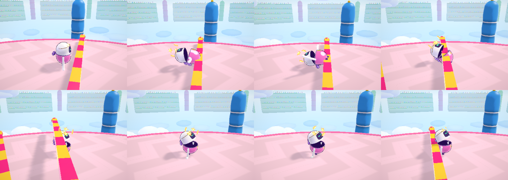

| cell | tick | sim stun | stars | body |
|---|---|---|---|---|
| before | -2 | 0 | - | visible |
| hit | +2 | 9 | ON | visible |
| mid-stun | +5 | 6 | ON | visible |
| get-up | +12 | 0 | ON | visible |
| +0.5 s | +26 | 0 | ON | visible |
| +1.5 s | +56 | 0 | ON | visible |
| +2.5 s | +86 | 0 | ON | visible |
| +3.3 s | +111 | 0 | ON | visible |

### mallet (def #0: push 900 cm/s, up 500 cm/s, stun 18 ticks = 0.60 s; hit at round tick 112)

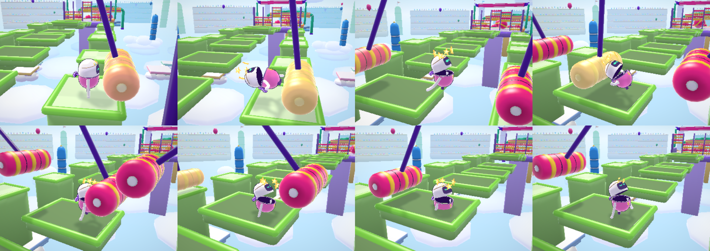

| cell | tick | sim stun | stars | body |
|---|---|---|---|---|
| before | -2 | 0 | - | visible |
| hit | +2 | 16 | ON | visible |
| mid-stun | +9 | 9 | ON | visible |
| get-up | +19 | 0 | ON | visible |
| +0.5 s | +33 | 0 | ON | visible |
| +1.5 s | +63 | 0 | ON | visible |
| +2.5 s | +93 | 0 | ON | visible |
| +3.3 s | +118 | 0 | ON | visible |

### ball (def #0: push 900 cm/s, up 500 cm/s, stun 18 ticks = 0.60 s; hit at round tick 177)

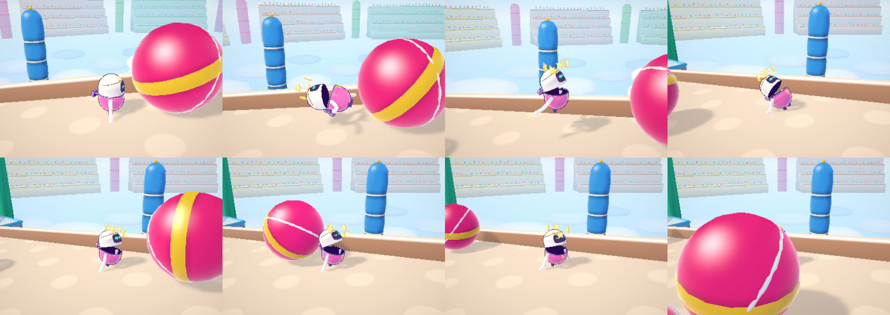

| cell | tick | sim stun | stars | body |
|---|---|---|---|---|
| before | -2 | 0 | - | visible |
| hit | +2 | 16 | ON | visible |
| mid-stun | +9 | 9 | ON | visible |
| get-up | +19 | 0 | ON | visible |
| +0.5 s | +33 | 0 | ON | visible |
| +1.5 s | +63 | 0 | ON | visible |
| +2.5 s | +93 | 0 | ON | visible |
| +3.3 s | +118 | 0 | ON | visible |

### bumper (def #0: push 600 cm/s, up 350 cm/s, stun 11 ticks = 0.37 s; hit at round tick 90)

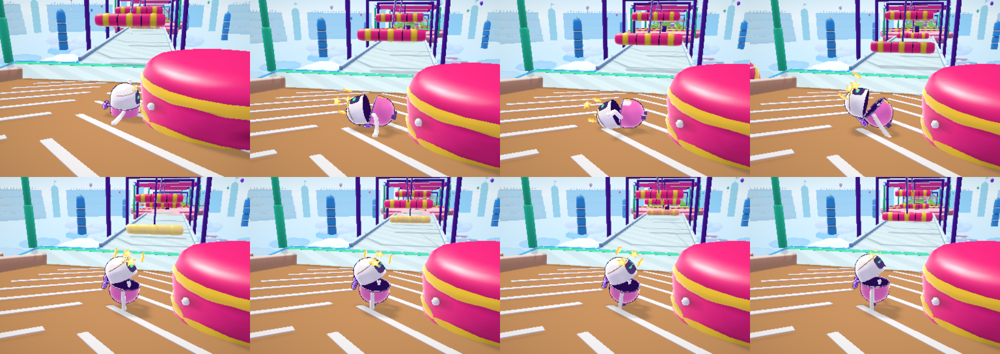

| cell | tick | sim stun | stars | body |
|---|---|---|---|---|
| before | -2 | 0 | - | visible |
| hit | +2 | 9 | ON | visible |
| mid-stun | +5 | 6 | ON | visible |
| get-up | +12 | 0 | ON | visible |
| +0.5 s | +26 | 0 | ON | visible |
| +1.5 s | +56 | 0 | ON | visible |
| +2.5 s | +86 | 0 | ON | visible |
| +3.3 s | +111 | 0 | ON | visible |

## goo-tower

- defs: spinner bars 1 (stun ticks 11), mallets 3 (11/18), rolling balls 2 (11/18), bumpers 7 (11)
- other obstacles (no knock in the sim): doors 3, platforms 2, turntables 0, conveyors 2, springs 2, falling blocks 3, tile grids 0, goo 1

### spinner (def #0: push 600 cm/s, up 350 cm/s, stun 11 ticks = 0.37 s; hit at round tick 112)

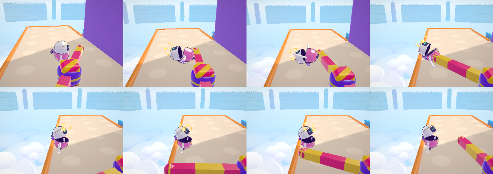

| cell | tick | sim stun | stars | body |
|---|---|---|---|---|
| before | -2 | 0 | - | visible |
| hit | +2 | 9 | ON | visible |
| mid-stun | +5 | 6 | ON | visible |
| get-up | +12 | 0 | ON | visible |
| +0.5 s | +26 | 0 | ON | visible |
| +1.5 s | +56 | 0 | ON | visible |
| +2.5 s | +86 | 0 | ON | visible |
| +3.3 s | +111 | 0 | ON | visible |

### mallet (def #0: push 600 cm/s, up 350 cm/s, stun 11 ticks = 0.37 s; hit at round tick 106)

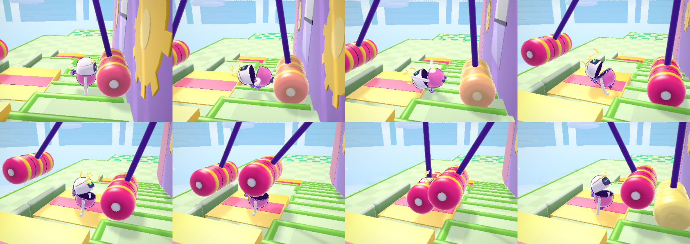

| cell | tick | sim stun | stars | body |
|---|---|---|---|---|
| before | -2 | 0 | - | visible |
| hit | +2 | 9 | ON | visible |
| mid-stun | +5 | 6 | ON | visible |
| get-up | +12 | 0 | ON | visible |
| +0.5 s | +26 | 0 | ON | visible |
| +1.5 s | +56 | 0 | ON | visible |
| +2.5 s | +86 | 0 | ON | visible |
| +3.3 s | +111 | 0 | ON | visible |

### ball (def #0: push 600 cm/s, up 350 cm/s, stun 11 ticks = 0.37 s; hit at round tick 125)

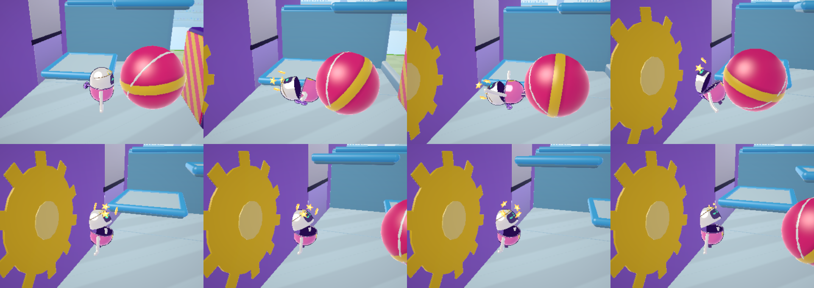

| cell | tick | sim stun | stars | body |
|---|---|---|---|---|
| before | -2 | 0 | - | visible |
| hit | +2 | 9 | ON | visible |
| mid-stun | +5 | 6 | ON | visible |
| get-up | +12 | 0 | ON | visible |
| +0.5 s | +26 | 0 | ON | visible |
| +1.5 s | +56 | 0 | ON | visible |
| +2.5 s | +86 | 0 | ON | visible |
| +3.3 s | +111 | 0 | ON | visible |

### bumper (def #0: push 600 cm/s, up 350 cm/s, stun 11 ticks = 0.37 s; hit at round tick 90)

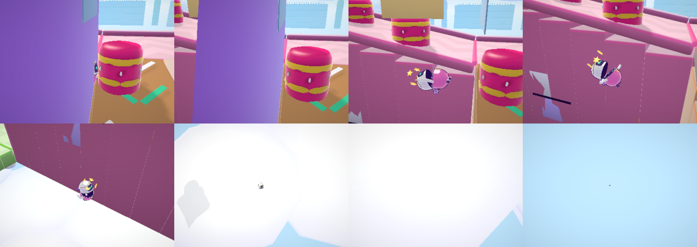

| cell | tick | sim stun | stars | body |
|---|---|---|---|---|
| before | -2 | 0 | - | visible |
| hit | +2 | 9 | ON | visible |
| mid-stun | +5 | 6 | ON | visible |
| get-up | +12 | 0 | ON | visible |
| +0.5 s | +26 | 0 | ON | visible (knocked off the course) |
| +1.5 s | +56 | 0 | ON | visible (knocked off the course) |
| +2.5 s | +86 | 0 | ON | visible (knocked off the course) |
| +3.3 s | +111 | 0 | ON | visible (knocked off the course) |

- this knock throws the Rushling off the course (it falls with the stars, then respawns dizzy)

## star-fountain

- defs: spinner bars 3 (stun ticks 11), mallets 0 (-), rolling balls 0 (-), bumpers 0 (-)
- other obstacles (no knock in the sim): doors 0, platforms 3, turntables 1, conveyors 0, springs 3, falling blocks 0, tile grids 0, goo 0

### spinner (def #0: push 600 cm/s, up 350 cm/s, stun 11 ticks = 0.37 s; hit at round tick 128)

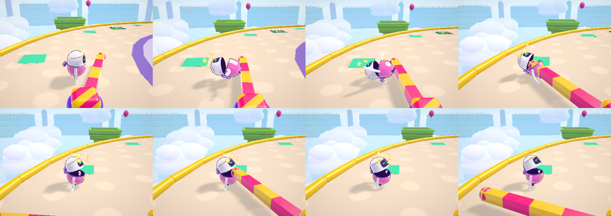

| cell | tick | sim stun | stars | body |
|---|---|---|---|---|
| before | -2 | 0 | - | visible |
| hit | +2 | 9 | ON | visible |
| mid-stun | +5 | 6 | ON | visible |
| get-up | +12 | 0 | ON | visible |
| +0.5 s | +26 | 0 | ON | visible |
| +1.5 s | +56 | 0 | ON | visible |
| +2.5 s | +86 | 0 | ON | visible |
| +3.3 s | +111 | 0 | ON | visible |

## crumble-shelf

- defs: spinner bars 1 (stun ticks 11), mallets 0 (-), rolling balls 0 (-), bumpers 0 (-)
- other obstacles (no knock in the sim): doors 0, platforms 0, turntables 0, conveyors 0, springs 0, falling blocks 0, tile grids 0, goo 0

### spinner (def #0: push 600 cm/s, up 350 cm/s, stun 11 ticks = 0.37 s; hit at round tick 684)

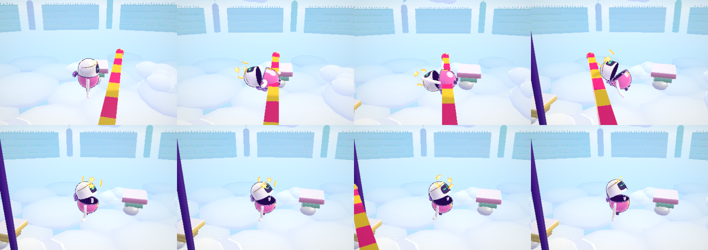

| cell | tick | sim stun | stars | body |
|---|---|---|---|---|
| before | -2 | 0 | - | visible |
| hit | +2 | 9 | ON | visible |
| mid-stun | +5 | 6 | ON | visible |
| get-up | +12 | 0 | ON | visible |
| +0.5 s | +26 | 0 | ON | visible |
| +1.5 s | +56 | 0 | ON | visible |
| +2.5 s | +86 | 0 | ON | visible |
| +3.3 s | +111 | 0 | ON | visible |

## sandbox

- defs: spinner bars 2 (stun ticks 11/15), mallets 1 (18), rolling balls 1 (18), bumpers 2 (11)
- other obstacles (no knock in the sim): doors 1, platforms 2, turntables 1, conveyors 1, springs 1, falling blocks 0, tile grids 0, goo 0

### spinner (def #0: push 900 cm/s, up 500 cm/s, stun 15 ticks = 0.50 s; hit at round tick 132)

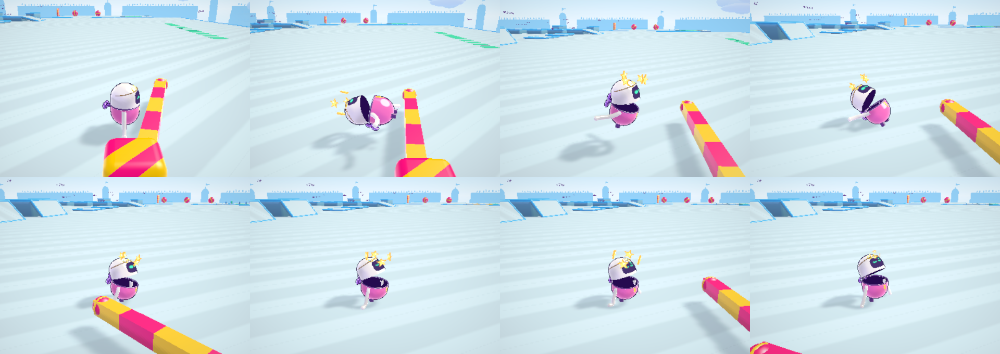

| cell | tick | sim stun | stars | body |
|---|---|---|---|---|
| before | -2 | 0 | - | visible |
| hit | +2 | 13 | ON | visible |
| mid-stun | +7 | 8 | ON | visible |
| get-up | +16 | 0 | ON | visible |
| +0.5 s | +30 | 0 | ON | visible |
| +1.5 s | +60 | 0 | ON | visible |
| +2.5 s | +90 | 0 | ON | visible |
| +3.3 s | +115 | 0 | ON | visible |

### mallet (def #0: push 900 cm/s, up 500 cm/s, stun 18 ticks = 0.60 s; hit at round tick 129)

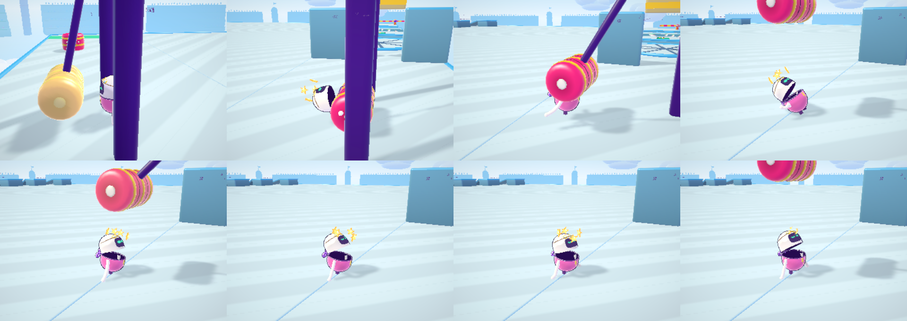

| cell | tick | sim stun | stars | body |
|---|---|---|---|---|
| before | -2 | 0 | - | visible |
| hit | +2 | 16 | ON | visible |
| mid-stun | +9 | 9 | ON | visible |
| get-up | +19 | 0 | ON | visible |
| +0.5 s | +33 | 0 | ON | visible |
| +1.5 s | +63 | 0 | ON | visible |
| +2.5 s | +93 | 0 | ON | visible |
| +3.3 s | +118 | 0 | ON | visible |

### ball (def #0: push 900 cm/s, up 500 cm/s, stun 18 ticks = 0.60 s; hit at round tick 93)

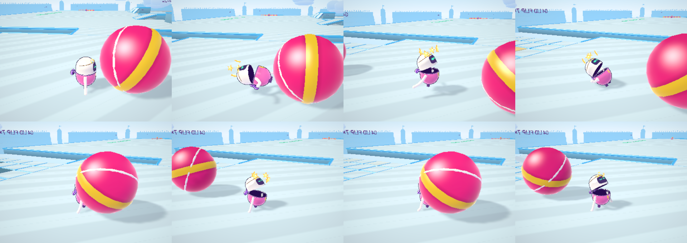

| cell | tick | sim stun | stars | body |
|---|---|---|---|---|
| before | -2 | 0 | - | visible |
| hit | +2 | 16 | ON | visible |
| mid-stun | +9 | 9 | ON | visible |
| get-up | +19 | 0 | ON | visible |
| +0.5 s | +33 | 0 | ON | visible |
| +1.5 s | +63 | 0 | ON | visible |
| +2.5 s | +93 | 0 | ON | visible |
| +3.3 s | +118 | 0 | ON | visible |

### bumper (def #0: push 600 cm/s, up 350 cm/s, stun 11 ticks = 0.37 s; hit at round tick 90)

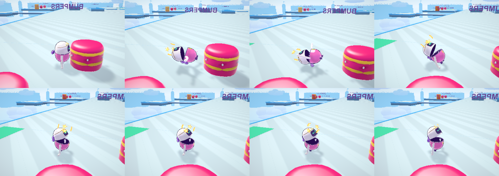

| cell | tick | sim stun | stars | body |
|---|---|---|---|---|
| before | -2 | 0 | - | visible |
| hit | +2 | 9 | ON | visible |
| mid-stun | +5 | 6 | ON | visible |
| get-up | +12 | 0 | ON | visible |
| +0.5 s | +26 | 0 | ON | visible |
| +1.5 s | +56 | 0 | ON | visible |
| +2.5 s | +86 | 0 | ON | visible |
| +3.3 s | +111 | 0 | ON | visible |

**PASS**: every knock def stuns, and the stars were on with the body visible in every hit and tail cell.
